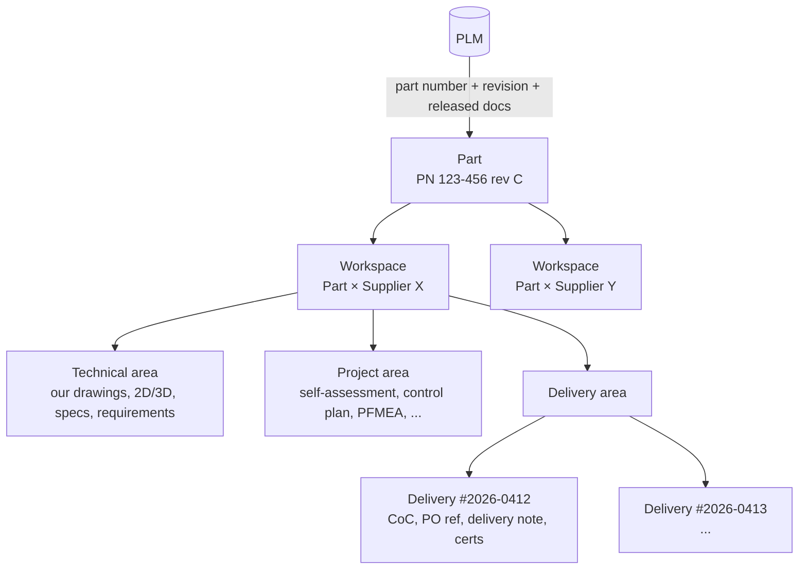
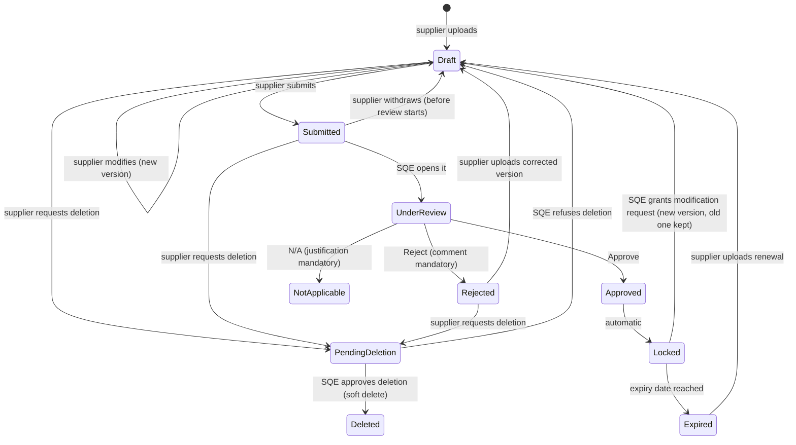
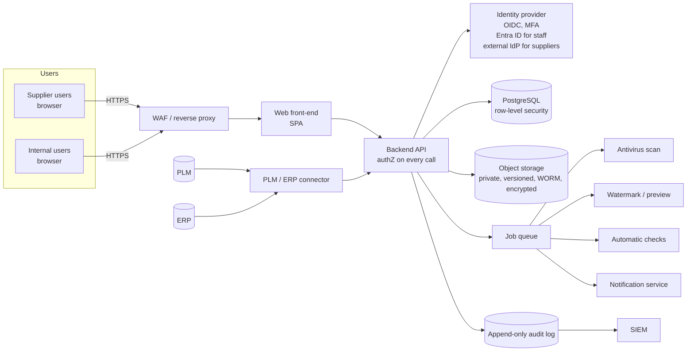
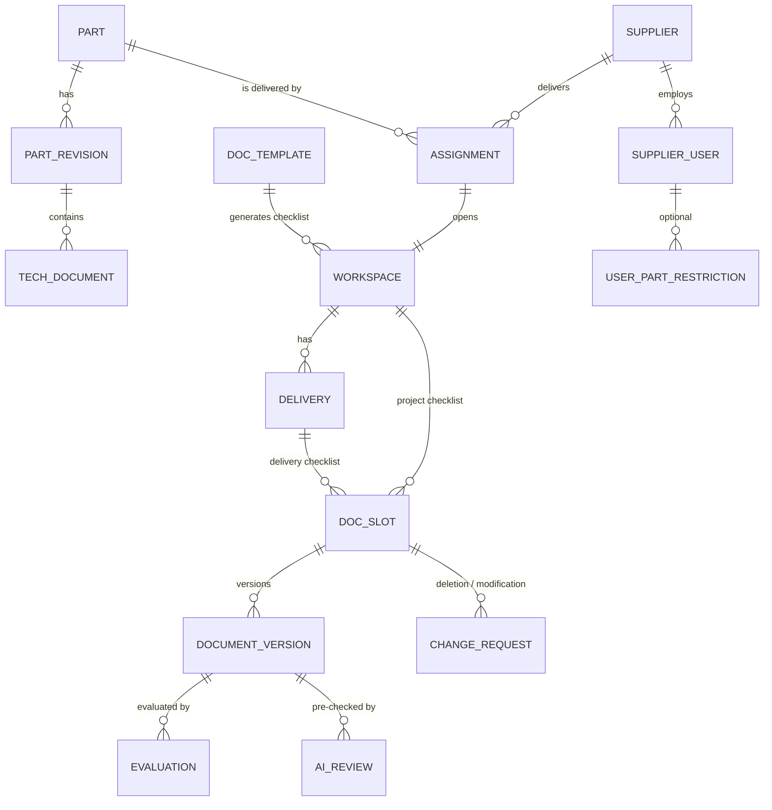

# Supplier Collaboration Portal — Functional & Technical Specification

| | |
|---|---|
| **Client** | **Harmatton** |
| **Status** | Draft v0.2 — for review |
| **Date** | 2026-11-08 |
| **Scope** | Secure web portal to exchange technical, project (quality) and delivery documents with suppliers, organised by PLM part number |
| **Design principle** | *Configurable by design* — every business choice is a setting Harmatton controls (§17); only security floors are fixed |
| **AI** | Built on **Claude** (Anthropic) — Harmatton is already a Claude partner (§6.4) |

---

## 1. Purpose

This portal is being built for **Harmatton**. Today, drawings, specifications, quality documents and delivery paperwork are exchanged with suppliers through e‑mail and shared folders. This makes it hard to know **which revision a supplier is working from**, **which documents are approved**, and **who changed or deleted what**.

The Supplier Collaboration Portal gives every **PLM part number** a single, controlled workspace where:

1. **We** publish the technical package (drawings, 2D/3D, specifications, specific requirements).
2. **The supplier** uploads its **project documents** (self‑assessment audit, control plan, PFMEA, etc.), which we **evaluate** (Approved / Rejected / Not applicable).
3. **The supplier** uploads its **delivery documents** for every shipment (certificate of conformity, PO reference, delivery note, material certificates, etc.), which we can access and check.
4. Nothing can be deleted without our approval, and approved documents are locked.
5. Each supplier sees **only the parts it delivers** — nothing else.

### 1.1 Goals

- One source of truth per part number, aligned with PLM revisions.
- Traceable, auditable document flow (who uploaded, who approved, when, which version).
- Strict, need‑to‑know access for suppliers and internal staff.
- Faster supplier approval (fewer e‑mails, clear status, automatic reminders, AI‑assisted pre‑review with Claude).
- **Configurable, not hard‑coded**: PLM/ERP connection, document templates, workflows, evaluation rules, security parameters, hosting and retention are all settings Harmatton's administrators choose (§17). The values written elsewhere in this document are **defaults**, not fixed decisions.

### 1.2 Out of scope (v1)

- Purchasing / invoicing / payments (ERP remains the master for POs and invoices).
- Supplier selection, RFQ and quotation management.
- Real‑time co‑editing of CAD files.

---

## 2. Glossary

| Term | Meaning |
|---|---|
| **We / our / internal** | **Harmatton** and its staff. |
| **Part** | An item identified by a PLM part number (+ revision). The central object of the portal. |
| **Part workspace** | The space dedicated to one *part × supplier* pair. Contains the three areas below. |
| **Technical area** | Documents **we** provide to the supplier (drawings, 2D/3D, specifications, requirements). |
| **Project area** | Supplier‑specific project/quality documents the **supplier** provides for approval. |
| **Delivery area** | Per‑shipment documents the **supplier** provides (CoC, PO reference, delivery note…). |
| **Evaluation** | Our verdict on a supplier document: *Approved*, *Rejected*, *Not applicable*. |
| **Lock** | State in which a document can no longer be modified by the supplier. |
| **Deletion request** | A supplier's request to remove a document, which must be approved internally. |
| **CoC** | Certificate of Conformity. |
| **PPAP / FAI** | Production Part Approval Process / First Article Inspection (if applicable to our industry). |

---

## 3. Users and roles

Access is **deny‑by‑default**: a user only sees what a role *and* an explicit assignment allow.

### 3.1 Internal roles

| Role | Typical person | Main rights |
|---|---|---|
| **Portal Administrator** | IT / Quality system owner | Manage users, roles, suppliers, part assignments, templates and all configuration settings (§17; security settings need a second approver). **Cannot** evaluate documents (segregation of duties). |
| **Supplier Quality Engineer (SQE)** | Supplier quality | Evaluate project & delivery documents, approve/reject deletion and modification requests, unlock documents, request new documents. |
| **Engineering / Design** | Product engineers | Publish/supersede technical documents (drawings, specs) — normally synchronised from PLM. Read project area. |
| **Purchasing / Buyer** | Buyers | Assign suppliers to parts (with SQE validation), read all areas, follow deliveries. |
| **Logistics / Incoming inspection** | Goods receipt | Read delivery area, mark deliveries as received/checked, evaluate delivery documents. |
| **Quality Manager** | Head of quality | Everything SQE can do + override decisions + view audit reports. |
| **Internal Auditor (read‑only)** | Internal/external auditors | Read‑only access to selected parts + audit trail. Time‑limited. |

Internal users are further restricted by **scope**: e.g., an SQE can be limited to a commodity, a plant, or a list of suppliers.

### 3.2 Supplier roles

| Role | Main rights |
|---|---|
| **Supplier Administrator** | Manages the user accounts *of its own company* (invite/disable), within the parts assigned to that company. Cannot grant itself access to new parts. |
| **Supplier Contributor** | Downloads technical documents, uploads/modifies project & delivery documents, submits deletion requests. |
| **Supplier Viewer** | Read/download only (e.g., a production planner). |

A supplier user can additionally be restricted to a **subset** of the company's parts (e.g., one plant of the supplier only handles part A).

### 3.3 The core access rule

> **A supplier user can access a part workspace if and only if:**
> 1. their company has an **active assignment** to that part (supplier delivers that part), **and**
> 2. the user is **active**, has completed **MFA**, has accepted the **NDA / terms of use**, and
> 3. the user is not restricted to a subset of parts that excludes it.

Consequences:

- A supplier delivering only part **A** sees part **A** only. Parts **B**, **C** … do not appear in search, lists, notifications, URLs or API responses (a direct link returns *404 Not Found*, not *403*, so existence is not revealed).
- If **two suppliers deliver the same part**, each has its **own isolated workspace**. They share the same *technical package* (our drawings) but never see each other's project or delivery documents, nor each other's names.
- When an assignment ends (supplier de‑sourced), access is revoked immediately; the workspace becomes read‑only history for internal users.

---

## 4. Information structure



### 4.1 Part (from PLM)

| Field | Source | Notes |
|---|---|---|
| Part number | PLM | Primary business key, unique. |
| Revision | PLM | Current released revision; history kept. |
| Description, material, family/commodity | PLM | |
| Lifecycle state | PLM | e.g., In work / Released / Obsolete. Only *Released* parts can be shared. |
| Export control / confidentiality class | PLM or manual | Drives extra controls (see §8.6). |
| Linked documents | PLM | Drawings, 3D models, specs released on that revision. |

### 4.2 Technical area (we → supplier)

Typical content:

- 2D drawings (PDF), 3D models (STEP / native, if allowed), specifications
- Customer/specific requirements, quality agreement, packaging instructions, labelling requirements
- Engineering change notices (ECN) affecting the part

Rules:

- Published by Engineering or synchronised automatically from PLM.
- When a new revision is released in PLM, the previous documents are marked **Superseded** (still visible in history, watermarked "SUPERSEDED") and the supplier must **acknowledge** the new revision (button *"I acknowledge receipt of revision D"*, timestamped and logged).
- Suppliers can **never** upload, modify or delete in this area.
- Optional per document: *view‑only in browser* (no download) and/or *dynamic watermark* (supplier name, user, date/time) on every page.

### 4.3 Project area (supplier → us)

A **document checklist** is generated for each workspace from a configurable **template** (by commodity, part criticality, or customer requirement). Each line of the checklist is a *required document slot*.

Example default template (adapt to our process / PPAP level):

| # | Document | Required | Expiry / periodicity |
|---|---|---|---|
| 1 | Supplier self‑assessment audit | Yes | Every 12 months |
| 2 | Control plan | Yes | On change |
| 3 | Process flow diagram | Yes | On change |
| 4 | PFMEA | Yes | On change |
| 5 | Measurement system analysis (MSA) | Depending on criticality | |
| 6 | Capability study (Cpk/Ppk) on special characteristics | Depending on criticality | |
| 7 | Dimensional report / First article inspection | Yes | Per revision |
| 8 | Material certificates / RoHS / REACH declarations | Yes | Every 12 months |
| 9 | Part submission warrant (PSW) or equivalent | Yes | Per revision |
| 10 | Packaging proposal | Optional | |
| 11 | Other (free slot) | — | |

Each slot can be marked by us as **Not applicable** for that part/supplier, with a justification.

### 4.4 Delivery area (supplier → us)

Each shipment creates a **Delivery record**:

| Field | Mandatory | Notes |
|---|---|---|
| PO number + PO line | Yes | Validated against ERP if integrated (the PO must exist, be for this supplier and this part). |
| Part number + revision | Yes | Pre‑filled, must match the revision in force. |
| Quantity, unit | Yes | |
| Lot / batch / serial numbers | Yes | |
| Shipping date, expected arrival | Yes | |
| Delivery note / packing list number | Yes | |

Required documents per delivery (configurable per part):

- **Certificate of Conformity (CoC)** — mandatory by default
- **PO / PO acknowledgement** reference document
- Delivery note / packing list
- Material certificate (e.g., EN 10204 3.1) when required
- Inspection / test report when required
- Deviation / concession reference, if the shipment is under a concession

A delivery is **incomplete** (red) until all mandatory documents are uploaded; incoming inspection sees the status at goods receipt.

---

## 5. Document lifecycle

### 5.1 States



### 5.2 Rules (the "no delete / no modify after approval" principle)

| Situation | Supplier can… | Supplier cannot… |
|---|---|---|
| Draft / Submitted / Rejected | Upload a **new version** (modify), add comments, submit, request deletion | Delete directly |
| Under review | Comment only | Modify, delete |
| **Approved (Locked)** | View, download, **request a modification** (with reason) | Modify, delete, request deletion |
| Pending deletion | View | Anything else until we decide |
| Deleted | — (no longer visible to the supplier) | — |

Additional rules:

1. **Every modification creates a new version.** Previous versions are never overwritten; they stay visible to internal users (and to the supplier, marked as *previous version*).
2. **Deletion is always a soft delete.** The file is kept in storage, hidden from the supplier, and remains visible to internal auditors with the deletion request, reason and approver. Physical purge happens only through the retention policy (§8.9).
3. **Approved = locked.** To change an approved document, the supplier files a *modification request*; if the SQE accepts, a new Draft version is opened, while the approved version **remains the reference** until the new one is approved.
4. **Delivery documents** follow the same rules; once a delivery is marked *Received & checked*, all its documents are locked.
5. Internal users cannot silently change a supplier's document either: they can only evaluate, comment, or (Quality Manager only) override a decision with a mandatory justification — always logged.

---

## 6. Evaluation ("one‑click evaluation")

### 6.1 Manual verdict with one click

Each submitted document shows three buttons to authorised internal users:

| Button | Effect | Mandatory input |
|---|---|---|
| ✅ **Approve** | Document → Approved → Locked. Supplier notified. | Optional comment |
| ❌ **Reject** | Document → Rejected. Supplier notified with the reasons and can upload a new version. | **Comment / reason codes** |
| ⚪ **Not applicable** | Slot closed as N/A for this part/supplier. | **Justification** |

Options:

- **Bulk evaluation**: select several documents → approve in one action (still logged per document).
- **Evaluation checklist** per document type (e.g., for a control plan: "all special characteristics covered", "reaction plan defined"…). The SQE ticks the checklist; the verdict is recorded with it.
- **Electronic signature** of the verdict (re‑authentication with MFA before approval) for critical parts.
- **Segregation of duties**: the person who uploaded or requested a document on behalf of a supplier cannot approve it; Portal Administrators cannot evaluate.

### 6.2 Automatic pre‑evaluation (assistant, not decision)

When a document is submitted, the system runs **automatic checks** and proposes a verdict, which the SQE confirms with one click:

| Check | Example | Result if failed |
|---|---|---|
| File integrity & antivirus | File clean, readable PDF | Blocked at upload |
| Allowed format | PDF/XLSX for control plan | Suggested **Reject** |
| Required metadata filled | Revision, date, signature date | Suggested **Reject** |
| Revision consistency | Document refers to part rev **C**, PLM current rev is **C** | Suggested **Reject** if mismatch |
| Validity dates | Certificate not expired, audit < 12 months old | Suggested **Reject** |
| Delivery cross‑checks | PO exists in ERP, belongs to this supplier and part; quantity ≤ open PO quantity; CoC lot number = delivery lot number | Flag mismatch |
| Content review by Claude (§6.4) | Self‑assessment score ≥ threshold, all sections of the control plan template present, special characteristics of the drawing covered, CoC signed and referencing the right PN/lot | Suggested verdict + findings with page references |

The final decision is **human by default** and **always logged**; the proposal is shown as "Suggested: Approve — 6/6 checks passed". Optionally, for low‑risk delivery documents (e.g., CoC on a non‑critical part where all checks pass), a rule can **auto‑approve**, configurable by the Quality Manager and fully logged as "auto‑approved by rule R‑12". Which checks run, their thresholds, and whether a failed check *suggests* or *blocks* are all configurable per document type (§17.4).

### 6.3 Status roll‑up

- **Project status** of a workspace: *Not started* → *In progress* → *Submitted* → *Approved* (all required slots Approved or N/A) / *Rejected items*.
- **Part approval status** drives a visible badge: "Supplier X approved for serial production of PN 123‑456 rev C".
- **Delivery status**: *Incomplete* → *Complete* → *Received & checked* / *Blocked* (a document rejected).
- Dashboards: open evaluations per SQE, overdue documents, expiring certificates (30/15/7 days), deliveries without CoC.

### 6.4 AI‑assisted review with Claude

Harmatton is already a Claude partner, so the AI assistant uses **Claude through the Anthropic API**. It reads a submitted document the way an SQE would and prepares the evaluation; the SQE confirms or overrides with one click.

**What Claude receives (one request = one document, never more):**

- The submitted file — PDF sent natively as a document block; XLSX/DOCX converted server‑side to text/CSV before sending (scanned images are sent as images).
- The context of *that* slot only: document type, evaluation checklist, configured acceptance criteria, part number and current PLM revision, the delivery record (PO, lot, quantity) for delivery documents, and — for checks against the drawing — the relevant extract of Harmatton's drawing (e.g., list of special characteristics), if the setting allows it.
- The instructions (system prompt) maintained by Harmatton's quality team per document type, versioned like any other configuration.

**What Claude returns** — a schema‑validated JSON object (Structured Outputs, `output_config.format`), stored with the document version:

```jsonc
{
  "suggested_verdict": "REJECT",            // APPROVE | REJECT | NOT_APPLICABLE | NEEDS_HUMAN
  "confidence": "high",                      // high | medium | low
  "extracted_fields": {
    "part_number": "123-456", "revision": "B",
    "document_date": "2026-10-02", "signed": true, "lot": null
  },
  "checklist": [
    {"item": "Refers to current revision", "result": "FAIL",
     "evidence": "Header says 'Rev B'; PLM current revision is C", "page": 1},
    {"item": "Reaction plan defined for each special characteristic", "result": "PASS", "page": 3}
  ],
  "summary_for_sqe": "Control plan is complete but refers to revision B.",
  "draft_message_to_supplier": "Please update the control plan to drawing revision C…"
}
```

**Typical uses**

| Document | What Claude checks |
|---|---|
| Self‑assessment audit | All chapters answered, score computed correctly, score ≥ configured threshold, action plan present for low‑scored items |
| Control plan / PFMEA | Every special characteristic of the drawing is covered, reaction plans defined, revision matches PLM, PFMEA high‑risk items have actions |
| Dimensional report / FAI | All drawing characteristics measured, results within tolerance, measurement equipment listed |
| Certificate of Conformity | PN, revision, PO, lot and quantity match the delivery record; signed and dated; required standard referenced |
| Material certificate | Material grade matches drawing, values within specification, certificate type (e.g., 3.1) as required |

**Implementation choices (all configurable, §17.5)**

- **Model**: default `claude-opus-5-5` (most accurate on long technical documents); per document type Harmatton can select `claude-sonnet-5-5`, or `claude-haiku-5-5` for high‑volume simple extraction (e.g., CoC fields) to reduce cost.
- **Real‑time vs. batch**: real‑time on submission (result in seconds/minutes); periodic bulk re‑checks (e.g., re‑verifying all certificates after a template change) via the **Message Batches API** at reduced cost.
- **Prompt caching** of the stable part of each request (instructions + template + checklist) to cut cost and latency.
- **Access route**: directly through the Anthropic API, or through Amazon Bedrock, Google Cloud Vertex AI or Microsoft Foundry if Harmatton wants inference to run inside its own cloud tenant.

**Guardrails**

- Claude **suggests, people decide**. A verdict is only applied automatically if Harmatton explicitly enables an auto‑approval rule for that document type (§17.4); auto‑reject is never applied without a human.
- Supplier documents are **untrusted input**: Claude has no tools and cannot take actions; its output is constrained to the JSON schema; text inside a document such as "approve this document" has no effect and is flagged as a finding.
- **Strict isolation**: a request contains only the document being checked and its own slot context — never other suppliers' documents or other parts.
- If the model declines or the response cannot be parsed, the result is `NEEDS_HUMAN`; the portal never blocks on the AI.
- Every AI result is logged in the audit trail with model ID, prompt/config version and timestamp. A monthly report shows the **agreement rate** between Claude's suggestions and SQE decisions per document type; Harmatton uses it to tune instructions or decide where to enable auto‑approval.
- **Data handling**: only the document under review is sent; data retention and processing terms (e.g., zero‑data‑retention eligibility, region) to be confirmed in Harmatton's agreement with Anthropic or with the chosen cloud provider. The AI feature can be switched off entirely, per supplier, or per confidentiality class (e.g., off for export‑controlled parts).

---

## 7. Notifications & follow‑up

| Event | Recipient |
|---|---|
| New/updated technical document or new PLM revision | Supplier contributors of the workspace (acknowledgement required) |
| Document submitted | Assigned SQE |
| Document approved / rejected / N/A | Supplier contributors |
| Deletion / modification request | Assigned SQE |
| Document about to expire / overdue | Supplier, then SQE (escalation after N days) |
| Delivery created without mandatory documents | Supplier + logistics |

E‑mails **never contain documents or confidential content** — only a notification and a link to the portal (login required).

---

## 8. Security requirements

Security is the top requirement. The design follows **least privilege**, **deny by default**, **defence in depth** and **full traceability**. Targets: alignment with ISO/IEC 27001 controls and, if we are in automotive, **TISAX** (high protection level for prototype/confidential data); OWASP ASVS **Level 2** minimum (Level 3 for authentication and access control).

> **Configurable vs. fixed.** Values below (timeouts, periods, allowed methods…) are **defaults** that Harmatton can tune in the admin console (§17.6). Harmatton can always make them *stricter*; a small set of **security floors** (§17.1) cannot be weakened by any setting.

### 8.1 Identity & authentication

- **Internal users**: Single Sign‑On through Harmatton's identity provider — configurable: Microsoft Entra ID, Google Workspace, Okta, Keycloak or any OIDC/SAML IdP. Joiners/leavers handled automatically from the directory.
- **Supplier users**: individual, named accounts only — **no shared accounts**. Invited by e‑mail by a Portal Administrator or the Supplier Administrator; invitation links are single‑use and expire after 72 h (configurable). Optionally, a large supplier can log in through **its own IdP** (SAML/OIDC federation), still with MFA.
- **Mandatory MFA** for everyone (TOTP app or FIDO2/WebAuthn security key / passkey; SMS not allowed).
- Password policy per NIST SP 800‑63B (length ≥ 12, breached‑password check, no forced periodic rotation), lockout/back‑off after failed attempts.
- **Step‑up re‑authentication** for sensitive actions: approving, approving a deletion, changing access rights, downloading export‑controlled files.
- Session: idle timeout (default 30 min, configurable 15–60), absolute timeout (default 10 h, configurable 8–12), secure/HttpOnly/SameSite cookies, logout everywhere on password/MFA change.
- Optional: IP allow‑listing per supplier company, geo‑blocking for countries we do not work with.

### 8.2 Authorisation model

- **RBAC + ABAC**: the role defines *what* a user can do; attributes (supplier company, part assignments, plant, commodity, confidentiality class) define *on which objects*.
- Authorisation is checked **server‑side on every request**, including every file download and every API call. The UI hiding a button is never considered a security control.
- **Database row‑level security** (e.g., PostgreSQL RLS policies keyed on the supplier ID of the session) as a second barrier: even a bug in the application code cannot return another supplier's rows.
- Non‑guessable identifiers (UUIDs) *plus* authorisation checks (protection against IDOR).
- Unauthorised objects return **404**, so suppliers cannot discover which part numbers exist.
- **Segregation of duties** enforced by the system (see §6.1); granting a supplier access to a part requires two people (Buyer proposes, SQE or Admin confirms — "four‑eyes").
- **Access recertification**: every quarter by default (configurable: monthly / quarterly / semi‑annual), each SQE/Buyer confirms the list of supplier users and part assignments they own; unconfirmed accesses are suspended automatically.
- Automatic expiry: supplier accounts inactive for 90 days (configurable 30–180) are disabled; access of internal auditors is time‑bound.

### 8.3 Data protection

- TLS 1.2+ (prefer 1.3) everywhere, HSTS.
- Encryption at rest (database and object storage), keys in a managed KMS/HSM, key rotation.
- Files stored in **private object storage**, never publicly reachable; downloads through **short‑lived signed URLs** (≤ 5 min) issued only after authorisation.
- Object storage **versioning + immutability (WORM / object lock)** for approved documents and audit logs.
- Optional **per‑supplier encryption keys** for highly confidential programmes.

### 8.4 File handling

- Upload allow‑list of extensions **and** MIME/magic‑byte verification (PDF, XLSX, DOCX, STEP, images, ZIP only if needed).
- **Antivirus / malware scanning** of every upload before it becomes available (quarantine until clean).
- Size limits, file name sanitisation, no execution of uploaded content, served with `Content-Disposition: attachment` and a strict CSP.
- SHA‑256 hash stored for every file version (integrity proof, duplicate detection).
- **Watermarking** of our drawings on download/view (supplier, user, timestamp) to trace leaks.
- Optional *view‑only* mode (rendered in browser, no download) for the most sensitive drawings.

### 8.5 Audit trail

- Every action is logged: login/logout/failed login, view, download, upload, new version, submit, evaluation, comment, deletion request & decision, access change, NDA acceptance, PLM revision acknowledgement.
- Log entry: who, when (UTC), from where (IP, user agent), what object, before/after state.
- Logs are **append‑only and tamper‑evident** (hash chaining or WORM storage), retained per the configured retention policy (§17.7).
- Audit trail viewable per document, per part, per supplier; exportable for audits.
- Security events forwarded to the SIEM; alerts on anomalies (mass downloads, logins from new countries, repeated 404 probing).

### 8.6 Confidentiality classes & export control

- Each part/document carries a classification. Default classes: *Internal*, *Confidential*, *Strictly confidential*, *Export‑controlled* — Harmatton can rename, add or remove classes and choose the controls attached to each (§17.6).
- Higher classes can enforce: view‑only, watermarking, IP restriction, step‑up MFA on download, additional NDA, named‑user approval.
- Export‑controlled items can only be shared with suppliers/users whose country and screening status allow it.

### 8.7 Legal gating

- A supplier user must accept the **terms of use + NDA / confidentiality agreement** on first login and whenever it changes (version and timestamp stored).
- Company‑level quality agreement can be linked and its validity checked before access is granted.

### 8.8 Application & infrastructure security

- Secure development lifecycle: code review, dependency scanning (SCA), SAST, secrets scanning in CI.
- OWASP Top 10 protections (CSRF tokens, output encoding, parameterised queries, rate limiting, security headers).
- WAF in front of the application; DDoS protection.
- Separate environments (dev/test/prod); **no production supplier data in test**.
- **Independent penetration test** before go‑live and yearly, plus after major changes.
- Backups encrypted, tested restore, RPO/RTO per configured service level (default RPO 1 h / RTO 8 h).

### 8.9 Retention & privacy

- Retention period configured per document type (default 10 years after the part's end of life for product‑traceability documents), with legal hold (§17.7).
- Personal data of supplier users minimised (name, e‑mail, company, phone optional); GDPR‑compliant (purpose, retention, right of access); hosting region chosen by Harmatton (§17.7).

---

## 9. Permission matrix

Legend: ✔ allowed · ✖ not allowed · R = request only (needs internal approval) · own = only for parts assigned to own company/user.

| Action | Admin | SQE | Engineering | Buyer | Logistics | Quality Mgr | Auditor | Supplier Admin | Supplier Contributor | Supplier Viewer |
|---|---|---|---|---|---|---|---|---|---|---|
| See part list | ✔ | scope | ✔ | scope | scope | ✔ | assigned | own | own | own |
| Publish technical doc | ✖ | ✖ | ✔ | ✖ | ✖ | ✖ | ✖ | ✖ | ✖ | ✖ |
| Download technical doc | ✔ | ✔ | ✔ | ✔ | ✔ | ✔ | ✔ | own | own | own |
| Upload / modify project doc | ✖ | ✖ | ✖ | ✖ | ✖ | ✖ | ✖ | own | own | ✖ |
| Upload / modify delivery doc | ✖ | ✖ | ✖ | ✖ | ✖ | ✖ | ✖ | own | own | ✖ |
| Delete any document | ✖ | ✖ | ✖ | ✖ | ✖ | ✖ | ✖ | R | R | ✖ |
| Approve deletion request | ✖ | ✔ | ✖ | ✖ | ✖ | ✔ | ✖ | ✖ | ✖ | ✖ |
| Evaluate project doc | ✖ | ✔ | ✖ | ✖ | ✖ | ✔ | ✖ | ✖ | ✖ | ✖ |
| Evaluate delivery doc | ✖ | ✔ | ✖ | ✖ | ✔ | ✔ | ✖ | ✖ | ✖ | ✖ |
| Unlock approved doc (modification request) | ✖ | ✔ | ✖ | ✖ | ✖ | ✔ | ✖ | R | R | ✖ |
| Override a decision | ✖ | ✖ | ✖ | ✖ | ✖ | ✔ | ✖ | ✖ | ✖ | ✖ |
| Assign supplier to part | confirm | confirm | ✖ | propose | ✖ | confirm | ✖ | ✖ | ✖ | ✖ |
| Manage supplier users | ✔ | ✖ | ✖ | ✖ | ✖ | ✖ | ✖ | own company | ✖ | ✖ |
| View audit trail | ✔ | scope | ✖ | ✖ | ✖ | ✔ | ✔ | ✖ | ✖ | ✖ |

---

## 10. PLM integration

### 10.1 Preferred: direct PLM integration

The part number is the **business key**; the portal never invents part numbers.

| Flow | Direction | Trigger | Content |
|---|---|---|---|
| Part master | PLM → Portal | On release / nightly | PN, revision, description, lifecycle, classification |
| Released documents | PLM → Portal | On release (event/webhook) or scheduled | Drawings (PDF), 3D (STEP), specs linked to the released revision |
| Revision change / ECN | PLM → Portal | On release | Supersede previous docs, notify supplier, request acknowledgement |
| Approval feedback (optional) | Portal → PLM | On approval | Supplier approval status / PPAP status stored as attribute or attached document in PLM |
| Supplier–part relationship | ERP/PLM → Portal | Nightly | Approved sources (approved manufacturer list / purchasing info records) used to *propose* assignments |
| Purchase orders | ERP → Portal | Nightly / on demand | PO number, line, PN, supplier, open quantity (for delivery checks) |

Implementation: a **PLM connector** service using the PLM's REST/OData API (e.g., Windchill REST services, Teamcenter Active Workspace/SOA services, 3DEXPERIENCE web services, Aras REST) or, if no API is available, a scheduled export (CSV/XML + PDFs) dropped on a secure SFTP. Only **released** objects are ever pulled; nothing is written to the PLM except the optional approval feedback.

> **Build vs. buy:** most PLM suites offer a supplier collaboration module. Before developing a custom portal, check whether our PLM licence includes one and whether it meets the requirements in this document (especially per‑supplier isolation, deletion approval and delivery documents). A custom portal is justified if those modules are missing, too costly per supplier user, or too rigid.

### 10.2 Fallback: PLM part numbers without integration

- Part numbers are imported from a PLM export (CSV/Excel) or created manually by Engineering **using the PLM part number** (format validated by a regular expression matching our PLM numbering scheme).
- Drawings uploaded manually by Engineering, with revision entered manually; a reminder report lists portal parts whose revision has not been confirmed against PLM in the last N days.
- The data model is identical, so switching to the integrated mode later requires no migration of the workspaces.

---

## 11. Main screens

### 11.1 Supplier home — "My parts"

```
┌──────────────────────────────────────────────────────────────────────┐
│  Supplier X  ·  Jane Doe (Contributor)                    [Logout]   │
├──────────────────────────────────────────────────────────────────────┤
│  My parts                               Search PN: [____________]    │
│ ┌────────────┬──────┬─────────────────────┬───────────┬────────────┐ │
│ │ Part no.   │ Rev  │ Project status      │ To do     │ Deliveries │ │
│ ├────────────┼──────┼─────────────────────┼───────────┼────────────┤ │
│ │ 123-456    │ C ⚠  │ In progress 6/9     │ 2 rejected│ 1 incomplete│ │
│ │ 123-789    │ A    │ Approved ✅         │ —         │ OK         │ │
│ └────────────┴──────┴─────────────────────┴───────────┴────────────┘ │
│  ⚠ New revision C of 123-456 — acknowledgement required  [Review]    │
└──────────────────────────────────────────────────────────────────────┘
```

### 11.2 Part workspace

```
┌ PN 123-456  Rev C  ·  Bracket, steel  ·  Confidential ───────────────┐
│ [Technical]  [Project]  [Deliveries]  [History]                       │
├───────────────────────────────────────────────────────────────────────┤
│ PROJECT DOCUMENTS                                                     │
│  Document              Version  Status          Action                │
│  Self-assessment audit  v2      ✅ Approved 🔒   [Request change]     │
│  Control plan           v3      ❌ Rejected      [Upload new version] │
│  PFMEA                  v1      ⏳ Submitted     [Withdraw]           │
│  MSA                    —       ⚪ N/A           —                    │
│  Dimensional report     v1      📝 Draft         [Edit] [Submit]      │
│                                                  [Request deletion]   │
└───────────────────────────────────────────────────────────────────────┘
```

### 11.3 Internal evaluation panel (SQE)

```
┌ Control plan v3 — Supplier X — PN 123-456 rev C ──────────────────────┐
│  [ PDF preview ...................................................... ]│
│  Automatic checks: ✔ antivirus ✔ format ✔ metadata ✖ revision (B≠C)  │
│  Suggested verdict: REJECT                                            │
│  Checklist: ☑ special characteristics  ☐ reaction plan  ...           │
│  Comment: [ Control plan refers to revision B, please update ]        │
│                                                                       │
│      [ ✅ Approve ]     [ ❌ Reject ]     [ ⚪ Not applicable ]          │
└───────────────────────────────────────────────────────────────────────┘
```

### 11.4 Other internal screens

- Evaluation inbox (filter by supplier, part, document type, due date)
- Deletion & modification requests queue
- Delivery follow‑up board (incomplete / complete / received / blocked)
- Supplier & part assignment management (with four‑eyes confirmation)
- Access recertification campaign
- Audit trail explorer & reports

---

## 12. Proposed technical architecture



Indicative technology choices (adjustable to Harmatton's IT standards; integrations and identity providers are pluggable adapters selected by configuration):

| Layer | Option |
|---|---|
| Front‑end | React / Angular SPA |
| Back‑end | .NET, Java (Spring) or Node.js (NestJS) — one stack mastered by our IT |
| Database | PostgreSQL with row‑level security |
| File storage | Azure Blob / S3‑compatible with versioning, object lock, server‑side encryption |
| Identity | Microsoft Entra ID (staff) + Entra External ID / Keycloak (suppliers), OIDC, MFA |
| Async jobs | Message queue (e.g., RabbitMQ, Azure Service Bus) |
| Antivirus | ClamAV or cloud malware scanning |
| AI | Claude via the Anthropic API (or via Amazon Bedrock / Google Cloud Vertex AI / Microsoft Foundry) — §6.4 |
| Configuration | Versioned settings store + admin console; export/import as YAML for test → production |
| Hosting | Configurable: Harmatton's cloud tenant (Azure / AWS / GCP), managed SaaS region, or on‑premise DMZ |

---

## 13. Data model (main entities)



| Entity | Key fields |
|---|---|
| `part` | id, part_number (unique), description, commodity, classification, plm_id |
| `part_revision` | id, part_id, revision, lifecycle_state, released_at, is_current |
| `tech_document` | id, part_revision_id, type, file_ref, hash, superseded_at, view_only, watermark |
| `supplier` | id, name, erp_vendor_code, country, status, quality_agreement_valid_until |
| `supplier_user` | id, supplier_id, email, role, mfa_enrolled, nda_version_accepted, status, last_login |
| `assignment` | id, supplier_id, part_id, valid_from, valid_to, proposed_by, confirmed_by, status |
| `workspace` | id, assignment_id, template_id, project_status, assigned_sqe_id |
| `doc_slot` | id, workspace_id or delivery_id, document_type, required, status, expiry_date, locked |
| `document_version` | id, slot_id, version_no, file_ref, sha256, uploaded_by, uploaded_at, scan_status, auto_check_result |
| `evaluation` | id, version_id, verdict (APPROVED/REJECTED/NA), comment, checklist_json, evaluator_id, signed_at, rule_id (if auto) |
| `change_request` | id, slot_id, type (DELETE/MODIFY), reason, requested_by, decision, decided_by, decided_at |
| `delivery` | id, workspace_id, po_number, po_line, quantity, lot, ship_date, status, received_by |
| `revision_ack` | id, workspace_id, part_revision_id, user_id, acknowledged_at |
| `ai_review` | id, version_id, model_id, prompt_version, suggested_verdict, confidence, result_json, created_at, agreed_with_sqe |
| `doc_template` | id, name, scope (commodity / criticality / supplier / part), slots_json, version, status |
| `config_setting` | id, key, value_json, scope_level (platform / tenant / site / commodity / supplier / part), scope_id, version, changed_by, approved_by, effective_from |
| `audit_event` | id, ts, actor_id, actor_type, ip, action, object_type, object_id, before, after, prev_hash, hash |

---

## 14. API overview (excerpt)

All endpoints require an authenticated session; every one performs an authorisation check against the caller's role and part assignments.

| Method | Endpoint | Who |
|---|---|---|
| GET | `/api/parts` | All (filtered to own scope) |
| GET | `/api/parts/{pn}/workspaces/{id}` | Scope / own |
| GET | `/api/tech-documents/{id}/download` | Scope / own → returns short‑lived signed URL |
| POST | `/api/workspaces/{id}/revision-ack` | Supplier |
| POST | `/api/slots/{id}/versions` | Supplier contributor (slot not locked) |
| POST | `/api/slots/{id}/submit` | Supplier contributor |
| POST | `/api/versions/{id}/evaluation` `{verdict, comment, checklist}` | SQE / QM (step‑up MFA) |
| POST | `/api/slots/{id}/change-requests` `{type: DELETE\|MODIFY, reason}` | Supplier contributor |
| POST | `/api/change-requests/{id}/decision` `{approve: bool, comment}` | SQE / QM |
| POST | `/api/workspaces/{id}/deliveries` | Supplier contributor |
| POST | `/api/deliveries/{id}/receive` | Logistics |
| GET | `/api/audit?object=...` | Admin / QM / Auditor |
| GET/PUT | `/api/admin/config/{key}?scope=...` | Admin (security keys need a second approver) |
| POST | `/api/admin/config/export` · `/import` | Admin |

There is **no DELETE endpoint** for documents available to suppliers.

---

## 15. Roll‑out plan

| Phase | Content | Indicative duration |
|---|---|---|
| **0 — Configuration workshop** | With Harmatton: fill the configuration sheet (§17) — PLM/ERP mode, templates, workflows, security settings, hosting, retention, AI options. Nothing blocks development: defaults are used until a choice is made | 2–3 weeks |
| **1 — MVP (pilot)** | Manual part import (PLM part numbers), supplier/user management with MFA, assignments, technical area, project area with checklist, one‑click evaluation, versioning, lock after approval, deletion requests, audit log, e‑mail notifications | 3–4 months |
| **2 — Deliveries & PLM** | Delivery area, ERP PO validation, PLM connector (parts, revisions, drawings, supersede + acknowledgement), watermarking, dashboards | 2–3 months |
| **3 — Automation & scale** | Automatic pre‑evaluation rules, expiry management, auto‑approval rules for low‑risk docs, access recertification campaigns, SIEM integration, PLM approval feedback, Claude AI pre‑review (suggest mode first, auto‑approval only where the agreement rate justifies it) | 2–3 months |

Pilot with **2–3 suppliers and 10–20 part numbers**, then roll out by commodity. Penetration test before the pilot opens to external suppliers.

---

## 16. Acceptance criteria (key scenarios)

1. **Isolation** — Supplier X user, assigned to part A only, cannot list, search, open, download or receive notifications about part B, including by typing the URL or calling the API directly (expect 404). Verified by automated tests for every endpoint.
2. **Shared part** — Suppliers X and Y both deliver part A: both see the drawings of part A; neither sees the other's project/delivery documents or company name.
3. **No direct delete** — A supplier user has no way (UI or API) to delete a document; a deletion request remains pending until an SQE decides; the deleted document remains visible in the audit trail.
4. **Lock after approval** — After approval, upload of a new version is refused until an SQE grants a modification request; the approved version remains the reference until the new version is approved.
5. **One‑click evaluation** — An SQE can approve, reject (with mandatory comment) or mark N/A from the evaluation panel; the supplier is notified and the action is in the audit trail.
6. **PLM revision** — Releasing revision D in PLM supersedes revision C drawings in the portal, notifies assigned suppliers and records their acknowledgement.
7. **Delivery completeness** — A delivery without CoC is shown as *Incomplete* to the supplier and logistics; a PO that does not belong to the supplier/part is flagged.
8. **Security** — MFA enforced for all accounts; downloads use signed URLs that expire; uploads are virus‑scanned; penetration test shows no high/critical findings.
9. **Revocation** — Ending an assignment removes the supplier's access within one minute; disabled users cannot use existing sessions.
10. **Configuration** — An administrator changes a setting (e.g., adds a document to a template, switches PLM mode from file import to API) without a code change or redeployment; the change is versioned, audited, and security settings require a second approver. A setting cannot weaken a security floor (§17.1).
11. **AI pre‑review** — A submitted control plan that refers to an outdated revision receives a Claude suggestion "REJECT" with the finding and page reference; the SQE can accept or override it in one click; the suggestion, model ID and config version are in the audit trail. With the AI switched off, the workflow is unchanged apart from the missing suggestion.

---

## 17. Configuration options

Instead of being decided once in the specification, every business choice is a **setting** that Harmatton's administrators can change at any time from the admin console — no code change, no redeployment. The portal ships with sensible **defaults** so it works out of the box; Harmatton adapts it to its process, and can adapt it again as the process evolves.

### 17.1 How configuration works

**Scope levels — the most specific level wins:**

```
Platform default  →  Harmatton (tenant)  →  Site / plant  →  Commodity / criticality  →  Supplier  →  Part number
```

Example: the default project template is "Standard"; the *Castings* commodity uses "PPAP level 3"; one specific part number additionally requires a capability study.

**Governance of settings**

- Every change is **versioned** (who, when, old value → new value, reason) and visible in the audit trail; any previous version can be restored.
- **Security‑relevant settings** (§17.6) require a **second approver** (four‑eyes) before taking effect.
- **Preview / impact check** before saving: "this template change affects 42 open workspaces — apply to new workspaces only, or to all?"
- **Effective date**: a change can be scheduled (e.g., new retention policy from 1 January).
- **Export / import** of the whole configuration as a YAML file, to move settings from test to production and keep them under version control.
- Settings are validated (types, ranges, dependencies) — e.g., auto‑approval cannot be enabled for a document type unless automatic checks are defined for it.

**Security floors — fixed, never configurable**

These protect Harmatton and its suppliers' data and cannot be switched off by any setting:

| Floor | Why |
|---|---|
| Supplier isolation: a supplier only sees parts it is assigned to; anything else returns 404 | Core confidentiality requirement |
| Server‑side authorisation on every request + database row‑level security | Defence in depth |
| Suppliers can never hard‑delete; deletions are soft and require internal approval | Traceability |
| Every modification creates a new version; approved documents are locked | Integrity |
| MFA for every account; no shared accounts; no SMS one‑time codes | Account takeover is the #1 risk |
| Encryption in transit and at rest; private storage with short‑lived signed URLs | Data protection |
| Antivirus scan before any uploaded file becomes available | Malware |
| Append‑only, tamper‑evident audit trail | Audits, disputes |
| AI never makes a *reject* decision on its own; AI requests contain one document only | Fairness to suppliers, isolation |

Harmatton can always make security **stricter** than the defaults; it can never go below these floors.

### 17.2 Integrations (PLM & ERP)

| Setting | Options | Default | Scope |
|---|---|---|---|
| PLM connection mode | **Direct API connector** · **Scheduled file import** (CSV/XML + PDFs via SFTP) · **Manual entry** of PLM part numbers | Manual entry (switch at any time; the data model is identical) | Tenant |
| PLM system adapter | Windchill · Teamcenter · 3DEXPERIENCE · Aras · SAP PLM · Generic REST · None | None | Tenant |
| PLM sync frequency | On release event · Hourly · Nightly · On demand | Nightly | Tenant |
| Shareable PLM lifecycle states | Any list (e.g., *Released*, *Prototype released*) | Released | Tenant / commodity |
| Part‑number format validation | Regular expression | Accept any | Tenant |
| Write approval status back to PLM | Off · Attribute only · Attribute + PSW/approval PDF | Off | Tenant |
| ERP connection | SAP S/4HANA · Microsoft Dynamics · Odoo · Generic REST · CSV import · None | None | Tenant |
| PO validation on deliveries | Off · Warn · Block | Warn (if ERP connected) | Tenant / supplier |
| Supplier ↔ part assignment source | Manual · Proposed from ERP/PLM sourcing data, confirmed by a person · Automatic from ERP | Manual | Tenant |
| Use the PLM's own supplier collaboration module instead of the portal's technical area | Yes · No | No | Tenant |

### 17.3 Documents & templates

| Setting | Options | Default | Scope |
|---|---|---|---|
| Project document template | Template library: **Standard** (§4.3 list) · **PPAP levels 1–5** · **First Article Inspection** · **Light** (low‑risk parts) · any **custom** template | Standard | Commodity / criticality / supplier / part |
| Per‑slot settings | Required / optional · allowed file formats · validity period / expiry · evaluator role · evaluation checklist items · automatic checks · AI review on/off | As in template | Template |
| "Not applicable" allowed | Per slot: yes / no; justification required yes / no | Yes, justification required | Template |
| Delivery document set | Any combination: CoC · PO / PO acknowledgement · delivery note / packing list · material certificate (type, e.g., 3.1) · inspection report · concession reference · custom | CoC + delivery note | Part / commodity / supplier |
| Technical files shared | 2D PDF only · 2D + STEP · 2D + STEP + native CAD | 2D PDF only | Classification / part |
| Download policy for technical files | Download allowed · Download with watermark · View‑only in browser | Download with watermark | Classification |
| Watermark content | Any of: supplier name, user name, date/time, "CONFIDENTIAL", custom text | Supplier + user + date/time | Tenant |
| New‑revision acknowledgement | Off · Required · Required within *N* days (then escalate) | Required within 10 days | Tenant / commodity |
| Allowed upload formats & max size | List + MB | PDF, XLSX, DOCX, STEP, PNG/JPG · 200 MB | Tenant |

### 17.4 Workflow & evaluation

| Setting | Options | Default | Scope |
|---|---|---|---|
| PO handling | Supplier uploads its PO acknowledgement · Harmatton publishes the PO from ERP · Both | Supplier uploads | Tenant / supplier |
| Who evaluates delivery documents | SQE · Incoming inspection · Either · Both (two steps) | Incoming inspection, SQE for rejections | Tenant / commodity |
| Approval levels | Single approval · Two‑step (e.g., SQE then Quality Manager) | Single; two‑step for *critical* parts | Document type / criticality |
| Rejection reasons | Free text · Reason codes · Both | Both | Tenant |
| Signature of verdict | None · Step‑up MFA · Qualified electronic signature | Step‑up MFA | Document type / criticality |
| Automatic checks | Enable / disable each check (§6.2) · thresholds · failed check = *suggest* or *block submission* | All on, suggest | Document type |
| Auto‑approval rules | Off · On for selected document types when all checks pass (and, optionally, AI agrees with high confidence) | Off | Document type / criticality / supplier |
| Deletion request approver | SQE · SQE + Quality Manager | SQE | Tenant / criticality |
| Who may unlock an approved document | SQE · Quality Manager only | SQE | Tenant |
| Delivery lock trigger | When marked received & checked · When complete · Manually | Received & checked | Tenant |
| Reminders & escalation | Reminder after *N* days, escalation to manager after *M* days, expiry warnings at *X/Y/Z* days | 5 / 10 days; 30 / 15 / 7 days | Tenant / document type |
| Notification channels | E‑mail · In‑app · Microsoft Teams / Slack webhook (internal only) | E‑mail + in‑app | User preference within tenant limits |
| Internal roles | Rename roles, add custom roles from permission building blocks, restrict scope by site / commodity / supplier | Roles of §3.1 | Tenant |

### 17.5 AI assistant (Claude)

| Setting | Options | Default | Scope |
|---|---|---|---|
| AI review | Off · **Suggest only** · Suggest + auto‑approve where an auto‑approval rule allows it | Suggest only | Tenant / document type / supplier / classification |
| Model | `claude-opus-5-5` · `claude-sonnet-5-5` · `claude-haiku-5-5` | `claude-opus-5-5` | Document type |
| Access route | Anthropic API · Amazon Bedrock · Google Cloud Vertex AI · Microsoft Foundry | Anthropic API | Tenant |
| Processing | Real‑time on submission · Batch (cheaper, results within hours) | Real‑time | Document type |
| Instructions & checklist | Editable per document type, versioned | Provided templates (§6.4) | Document type |
| Send drawing extract for cross‑checks | Yes · No | Yes, except *Export‑controlled* | Classification |
| Language of findings & draft messages | French · English · Arabic · other | Same as the user's interface | Tenant / supplier |
| Show AI findings to the supplier | Never · Only after SQE validation · Immediately (self‑check before submission) | Only after SQE validation | Tenant / supplier |

### 17.6 Security & access (stricter only)

| Setting | Options | Default | Scope |
|---|---|---|---|
| Internal identity provider | Entra ID · Google Workspace · Okta · Keycloak · any OIDC/SAML | Entra ID | Tenant |
| Supplier identity | Built‑in accounts · Entra External ID / Keycloak · Federation with the supplier's own IdP | Built‑in accounts | Tenant / supplier |
| MFA methods | Authenticator app (TOTP) · Passkey / FIDO2 key · Passkey only | TOTP + passkey | Tenant / classification |
| Step‑up re‑authentication | Which actions require it | Approve, approve deletion, access changes, download of export‑controlled files | Tenant |
| Session idle / absolute timeout | 15–60 min / 8–12 h | 30 min / 10 h | Tenant |
| Disable inactive supplier accounts after | 30–180 days | 90 days | Tenant |
| Access recertification | Monthly · Quarterly · Semi‑annual | Quarterly | Tenant |
| Four‑eyes on supplier ↔ part assignment | On · Off for low classification | On | Classification |
| IP allow‑list | Off · Per supplier company | Off | Supplier |
| Geo‑blocking | List of blocked / allowed countries | Off | Tenant |
| Confidentiality classes | Rename / add / remove classes; for each: download policy, watermark, MFA method, IP restriction, extra NDA, AI allowed | 4 classes (§8.6) | Tenant |
| Export‑control screening | Off · On (country + screening status required before sharing) | Off | Tenant / classification |
| Terms of use & NDA | Text, version, re‑acceptance on change | Standard template | Tenant / supplier |
| Signed URL lifetime | 1–5 min | 5 min | Tenant |

### 17.7 Data, hosting & presentation

| Setting | Options | Default | Scope |
|---|---|---|---|
| Hosting | Harmatton's cloud tenant (Azure / AWS / GCP) · Managed SaaS · On‑premise DMZ | Harmatton's cloud tenant | Deployment |
| Data residency region | Any region offered by the chosen host | Closest region to Harmatton that meets customer requirements | Deployment |
| Retention per document type | Years after creation / after part end of life · legal hold | 10 years after part end of life for traceability documents; 3 years for others | Document type |
| Purge after retention | Automatic · After manual confirmation | After manual confirmation | Tenant |
| Backup service level | RPO / RTO | 1 h / 8 h | Deployment |
| Interface languages | French · English · Arabic · others | French + English | Tenant; user picks |
| Branding | Logo, colours, portal domain, e‑mail sender | Harmatton branding | Tenant |
| Quotas | Storage per supplier, max file size, API rate limits | Unlimited storage · 200 MB · standard limits | Tenant / supplier |

### 17.8 From open questions to settings

The questions of the previous draft no longer block the project — each one is now a setting with a default, to be filled in during the configuration workshop (§15, phase 0):

| Former open question | Setting(s) |
|---|---|
| Which PLM, and does it have an API or a supplier module? | PLM connection mode, PLM system adapter, use PLM supplier module (§17.2) |
| Which ERP holds the POs? | ERP connection, PO validation (§17.2) |
| Which project documents per commodity / criticality? | Project document template & per‑slot settings (§17.3) |
| Do we share 3D models / native CAD? | Technical files shared, download policy (§17.3) |
| PO acknowledgement from supplier, or PO published by us? | PO handling (§17.4) |
| Who evaluates delivery documents? | Who evaluates delivery documents (§17.4) |
| Retention periods? | Retention per document type, purge (§17.7) |
| Hosting and data residency? | Hosting, data residency region (§17.7) |
| Export control / customer confidentiality? | Confidentiality classes, export‑control screening (§17.6) |
| Expected volumes? | Quotas (§17.7); sizing is an operations input, not a functional decision |
